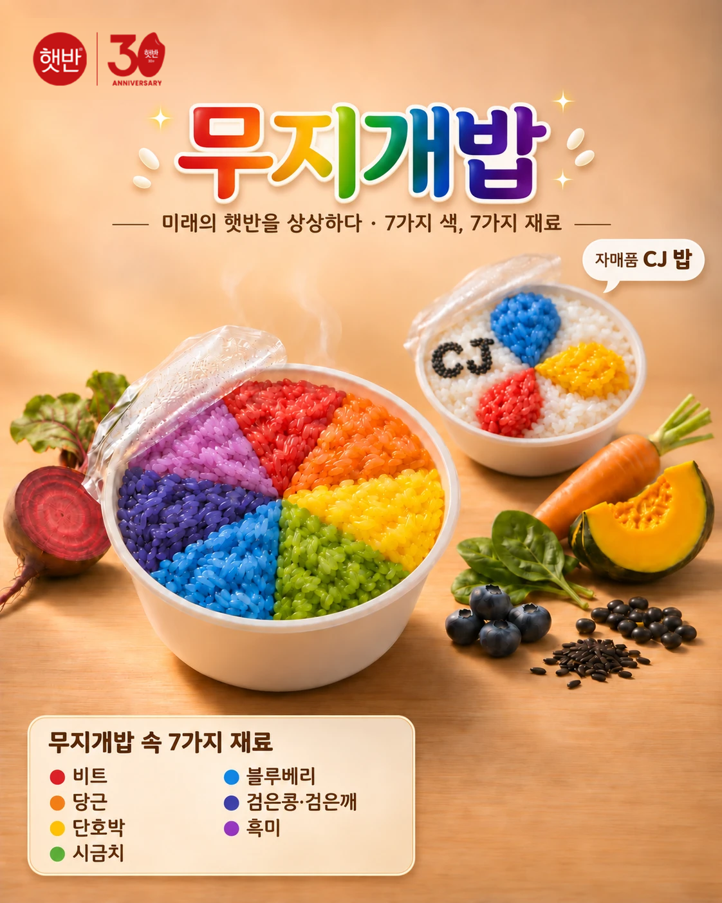

# 🌈 무지개밥 — 햇반 30주년 AI 공모전 출품작

> 부문: **01. 미래의 햇반을 만들어밥 (이미지)**
> 사용 AI: ChatGPT (이미지 생성·보정·타이포), Claude (기획·프롬프트·로고/문구 합성)



## 아이디어
동그란 햇반 용기 안에 **피자처럼 7조각으로 나눈 빨주노초파남보 쌀밥**을 담았어요.
한 그릇으로 7가지 재료와 영양소를 함께 먹을 수 있는 "미래의 햇반"이에요.

| 색 | 재료 |
|---|---|
| 🔴 빨강 | 비트 |
| 🟠 주황 | 당근 |
| 🟡 노랑 | 단호박 |
| 🟢 초록 | 시금치 |
| 🔵 파랑 | 블루베리 |
| 🟣 남색 | 검은콩·검은깨 |
| 🟤 보라 | 흑미 |

**자매품 CJ 밥**: 흰 밥 위에 CJ 심볼 꽃잎 3장(파랑·노랑·빨강)을 올리고, 검은깨로 "CJ" 글자를 썼어요.

## 제작 과정
1. Claude와 아이디어·재료·구도를 정리하고 영어 프롬프트 작성
2. ChatGPT로 사진 생성·수정 (`v2_01` → `v2_04`)
3. Claude가 로고와 문구 합성 (`최종_무지개밥_v2.png`)
4. ChatGPT로 글자를 광고 포스터 스타일로 꾸밈 (`v3_gpt_포스터.webp`)
5. 원본 로고를 다시 덮어씌워 최종본 완성 (`최종_무지개밥_v3.png`)

## 폴더 구조
```
햇반아이디어/
├── README.md              # 이 파일
├── 진행상황.md             # 작업 현황, 남은 할 일 (새 세션은 여기부터 읽기)
├── 공모전 관련내용.md       # 공모 요강·규정·심사기준
├── 내 아이디어.md           # 아이디어, 재료표, 구도, 프롬프트
├── 이미지(초안)/            # 초기 시안
└── 생성결과/                # AI 생성 과정 + 최종본
    ├── v2_01~04.webp
    ├── v3_gpt_포스터.webp
    └── 최종_무지개밥_v3.png  # ⭐ 최종 제출본
```

## 참고
- 이 작품은 공모전 출품용 **콘셉트 이미지**이며 실제 판매 제품이 아닙니다.
- 햇반·CJ 로고와 상표의 권리는 CJ제일제당에 있습니다. 공식 로고 원본 파일은 저장소에 포함하지 않았습니다.
- 해시태그: `#햇반 #햇반AI공모전 #갓지은아이디어`
